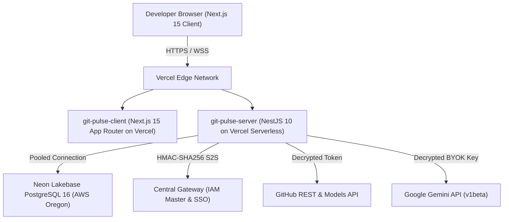

# Git Pulse Architecture & Technical Specifications

This document outlines the architectural blueprint, security protocols, AI execution models, and data flows of **Git Pulse**.

---

## 1. Ecosystem Alignment (Prism Hub)

Git Pulse is a core intelligence layer within the **Prism Hub** ecosystem, delivering developer productivity analytics and automated standup report synthesis:

- **Git Pulse Client**: [git-pulse-app.vercel.app](https://git-pulse-app.vercel.app) (Local: `http://localhost:6100`)
- **Git Pulse Server**: [git-pulse-server.vercel.app/api/v1](https://git-pulse-server.vercel.app/api/v1) (Local: `http://localhost:6101`)
- **Central Gateway (SSO & IAM)**: [central-gateway-client.vercel.app](https://central-gateway-client.vercel.app) (Local: `http://localhost:5100` / `5101`)
- **Wonderlab**: [wonderlab.io.vn](https://wonderlab.io.vn) (Local: `http://localhost:4100` / `4101`)
- **Production Database**: Neon Lakebase PostgreSQL 16 (`us-west-2` AWS Oregon) with connection pooling.
- **Local Database**: PostgreSQL 16 Docker container on `127.0.0.1:5432` (`git_pulse`).

---

## 2. Authentication Architecture

### 2.1 Central Gateway IAM (Google SSO)

All users authenticate centrally through **Central Gateway**:

1. Git Pulse Client initiates Google Sign-In or OAuth2 with PKCE flow forwarding to `server/src/auth`.
2. Git Pulse Server communicates with Central Gateway via HMAC-signed Service-to-Service (S2S) requests.
3. Upon Gateway identity validation, Git Pulse syncs a local shadow profile in the `users` table and issues a secure HttpOnly session cookie (`git_pulse_session`). Offline JWT verification ensures sub-millisecond route guards with zero latency overhead.

### 2.2 Service-to-Service (S2S) Cryptographic Protocol

Cross-service communication between Git Pulse, Central Gateway, and Wonderlab enforces HMAC-SHA256 digital signatures with a strict 5-minute replay window:

- **Pre-Shared Symmetric Secrets**: Stored in `service_connections` PostgreSQL table (`slug`, `domain`, `apiKey`, `incomingSecret`).
- **Encrypted-at-Rest Secrets (S2S Vault)**: All secrets in PostgreSQL are encrypted using AES-256-GCM (`enc:v1:<iv>:<tag>:<ciphertext>`) via `s2s-vault.util.ts`. Production strictly enforces a dedicated 256-bit `S2S_ENCRYPTION_KEY`.
- **Cryptographic Headers**:
  - `X-S2S-Service`: Identity slug of sending service (`git-pulse`).
  - `X-S2S-Timestamp`: Epoch timestamp in ms (`Date.now()`). Max clock skew allowable: 5 minutes (`300,000ms`).
  - `X-S2S-Signature`: HMAC-SHA256 hex digest of `${timestamp}.${method}.${normalizedPath}.${canonicalBody}` signed with the decrypted shared secret.
- **Constant-Time Verification**: Enforces `crypto.timingSafeEqual` in `S2SAuthGuard` to prevent timing side-channel attacks.

### 2.3 GitHub Integration & Token Security (OAuth / PAT)

1. Developers link GitHub credentials via Personal Access Token (Fine-Grained or Classic) or 1-Click OAuth.
2. **Multi-Layer Cryptographic Hardening**:
   - Stored using **AES-256-GCM** with **Per-User HKDF Key Derivation**:
     $$\text{DEK}_{\text{user}} = \text{HKDF-SHA256}(\text{MasterKey}, \text{Salt}=\text{userId}, \text{Info}=\text{"git-pulse-token-v1"}, 32)$$
   - Production fail-fast: Server strictly requires 256-bit `GITHUB_TOKEN_ENCRYPTION_KEY` in production.
   - Key versioning (`keyVersion`) allows seamless zero-downtime key rotation.
3. **Least Privilege & Scope Guardrails**:
   - Detects over-privileged scopes (`delete_repo`, `admin:org`, `workflow`) and flags warnings on the client UI.
   - Tracks token expiration date (`expiresAt`) for Fine-Grained PATs.
4. **Lifecycle & Self-Healing**:
   - Automatic `REVOKED` status transition upon HTTP 401 Bad Credentials from GitHub API, halting background polling immediately.
   - User disconnect irrevocably purges encrypted tokens and logs a `DISCONNECT` audit record.
5. **Zero-Leak Redaction & Audit Logs**:
   - Global regex redaction for `ghp_`, `github_pat_`, and `gho_` tokens in logs and traces.
   - Detailed `token_audit_logs` record every decryption, save, and revocation with client IP and User-Agent.
   - Rate limited with NestJS Throttler (`@Throttle` 5 attempts/min on sensitive token routes).

---

## 3. Configurable AI Providers & Personal BYOK Vault

Git Pulse supports pluggable AI providers with **Zero Server Compute Costs** and live pre-flight model availability checks:

1. **Groq Cloud (Recommended Personal BYOK Vault in `ai_connections`)**:
   - High-speed LPU inference with 100% free tier (no credit card or Google Cloud billing required).
   - Users connect personal Groq API keys (`gsk_...` from `https://console.groq.com/keys`) via `POST /api/v1/ai/connections`, encrypted per-user with **AES-256-GCM + HKDF-SHA256** (`CryptoService`) and displayed in the UI as `Groq Cloud (<label>)`.
   - Models include `llama-3.3-70b-versatile`, `deepseek-r1-distill-llama-70b`, `llama-3.1-8b-instant`, `mixtral-8x7b-32768`.
   - Live availability checks target `https://api.groq.com/openai/v1/chat/completions` with 1-token probes and live model synchronization via `/models`.
2. **Google Gemini (Personal BYOK Vault in `ai_connections`)**:
   - Users connect personal Google AI Studio keys (`AIza...` or `AQ...`) via `POST /api/v1/ai/connections`, encrypted per-user with **AES-256-GCM + HKDF-SHA256** (`CryptoService`) and displayed in the UI as `Google Gemini (<label>)`.
   - Live model discovery (`GET /v1beta/models`) filters active standup text-generation models (prioritizing verified GA Flash/Flash-Lite tiers) and runtime availability probes (`GET /v1beta/models/{model}` + minimal 1-token `:generateContent`) verify key validity, Free Tier `limit: 0` quota, and model responsiveness whenever the user selects a provider/model.
3. **GitHub Models (Deprecated / Service Retired)**:
   - Previously targeted `https://models.github.ai/catalog/models` and `/inference/chat/completions`.
   - The service was officially retired by GitHub on July 30, 2026. Git Pulse availability check detects this status and cleanly notifies users to utilize Groq Cloud or Google Gemini.

---

## 4. Activity Scanner & Commit Selection Architecture

Git Pulse features a streamlined, focused activity scanner and cockpit:

1. **Three Focused Grouping Modes**:
   - **Tất cả (All)**: Unified view organized by Personal activity and Organizations.
   - **Theo Task (By Task)**: Groups activities under user-defined tracking tasks or unassigned backlog.
   - **Theo Repo (By Repo)**: Groups activities alphabetically by repository.
2. **Clean Activity Stream**:
   - Direct activity cards (`PrActivityCard`) present PR and commit information without cluttering individual selection checkboxes.
3. **Cockpit Commit Selector Modal (`CommitSelectionModal`)**:
   - Opened directly from the `{count} commit đã chọn` trigger row above the `Tạo báo cáo` action button.
   - Allows fine-grained inspection and checkbox toggling of individual commits grouped by PR/Repo.
   - Persistent filter preferences: Checkboxes for **Cá nhân (Personal)** and **Tổ chức (Organization)** are stored in `localStorage` (`gitpulse:commit_filter:personal`, `gitpulse:commit_filter:org`) and automatically applied to new scans.
   - The AI summarization pipeline (`api.ai.summarize`) filters PR activities strictly down to selected commits before prompt synthesis.
