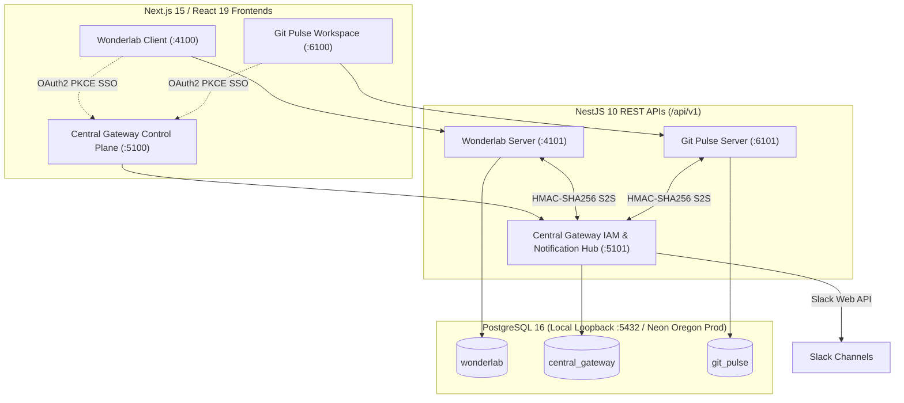

# Prism Hub — Shared Ecosystem Architecture & Security

**Prism Hub** unifies three tightly decoupled NestJS 10 + Next.js 15 monorepos connected via cryptographic Service-to-Service (S2S) messaging and centralized Single Sign-On (SSO).

---

## 1. Ecosystem Service Registry & Standard Ports

| Service             | Submodule Path             | Local Client | Local Server (`/api/v1`) | Local DB (`127.0.0.1:5432`) | Production Client                                                              | Production API                                                                          |
| :------------------ | :------------------------- | :----------: | :----------------------: | :-------------------------- | :----------------------------------------------------------------------------- | :-------------------------------------------------------------------------------------- |
| **Wonderlab**       | `services/wonderlab`       |    `4100`    |          `4101`          | `wonderlab`                 | [wonderlab.io.vn](https://wonderlab.io.vn)                                     | [wonderlab-server.vercel.app](https://wonderlab-server.vercel.app/api/docs)             |
| **Central Gateway** | `services/central-gateway` |    `5100`    |          `5101`          | `central_gateway`           | [central-gateway-client.vercel.app](https://central-gateway-client.vercel.app) | [central-gateway-server.vercel.app](https://central-gateway-server.vercel.app/api/docs) |
| **Git Pulse**       | `services/git-pulse`       |    `6100`    |          `6101`          | `git_pulse`                 | [git-pulse-app.vercel.app](https://git-pulse-app.vercel.app)                   | [git-pulse-server.vercel.app](https://git-pulse-server.vercel.app/api/docs)             |

---

## 2. Ecosystem Topology

---

## 3. Centralized IAM, OAuth2 PKCE & Shadow User Sync

1. **Central Gateway as IAM Authority**: Central Gateway holds authoritative user credentials (`Argon2id` password hashes), Google Identity linkage, session cookies (`gateway_session`), and user activation flags (`isActive`).
2. **OAuth2 Authorization Code + PKCE (`S256`)**: Child applications authenticate via RFC 7636 PKCE (`GET /api/v1/auth/oauth/authorize` -> `POST /api/v1/auth/oauth/token`) or BFF S2S auth proxying.
3. **Zero-Fallback Shadow Profiles**: Child services (`wonderlab`, `git-pulse`) persist local shadow profiles (`id`, `username`, `email`, `role`, `avatarUrl`, `isActive`) for foreign key integrity, without storing local passwords.
4. **Offline JWT Session Verification**: After issuing an `HttpOnly`, `SameSite: Lax` cookie (`wonderlab_session`, `git_pulse_session`), every subsequent child API request validates the JWT locally in memory with zero roundtrips to Central Gateway.
5. **Real-Time Profile & Status Broadcasts**: Profile updates (`PATCH /auth/profile`) and admin account status toggles (`PATCH /auth/users/:id/status`) trigger `POST /api/v1/internal/users/sync` to active services registered with `metadata.syncUser = true`.

---

## 4. Service-to-Service (S2S) Cryptographic Architecture

1. **Dynamic Service Registry (`service_connections`)**: Microservice base URLs (`domain`), prefixes (`apiPrefix`), outbound keys (`apiKey`), and inbound verification secrets (`incomingSecret`) live in PostgreSQL rather than hardcoded static backend URLs.
2. **Encrypted-at-Rest Vault (`s2s-vault.util.ts`)**: Secrets in `service_connections` use AES-256-GCM authenticated encryption formatted as `enc:v1:<iv>:<tag>:<ciphertext>`. Production enforces a 256-bit `S2S_ENCRYPTION_KEY` (fail-fast at startup if missing) while retaining seamless plaintext migration compatibility.
3. **HMAC-SHA256 Signed Transport & Anti-Replay**:
   - Outbound `S2SService.call(...)` decrypts `apiKey` strictly in memory and signs requests with:
     - `X-S2S-Service`: Calling service slug
     - `X-S2S-Timestamp`: Millisecond epoch timestamp (5-minute / `300,000ms` replay window)
     - `X-S2S-Signature`: HMAC-SHA256 hex digest of `${timestamp}.${method}.${normalizedPath}.${canonicalBody}`
   - Inbound `S2SAuthGuard` verifies timestamps and compares digests in constant time using `crypto.timingSafeEqual`.
4. **Notification Broker Guards**:
   - `NotificationAuthGuard` on Central Gateway accepts either S2S HMAC signatures or timing-safe `Authorization: Bearer <GATEWAY_SECRET_KEY>` for GitHub Actions CI/CD workflows.

---

## 5. Non-Negotiable Security Boundaries

- **Zero Secret Commits**: `.env*` files (except `.env.example`) are strictly excluded via `.gitignore`.
- **Client Env Isolation**: Only `NEXT_PUBLIC_*` variables are permitted inside `client/` code.
- **CORS Whitelisting**: `CORS_ORIGINS` / `CORS_ORIGIN` apply strictly to browser origins, never S2S server calls.
- **Database Loopback**: Local PostgreSQL binds strictly to `127.0.0.1:5432`.
