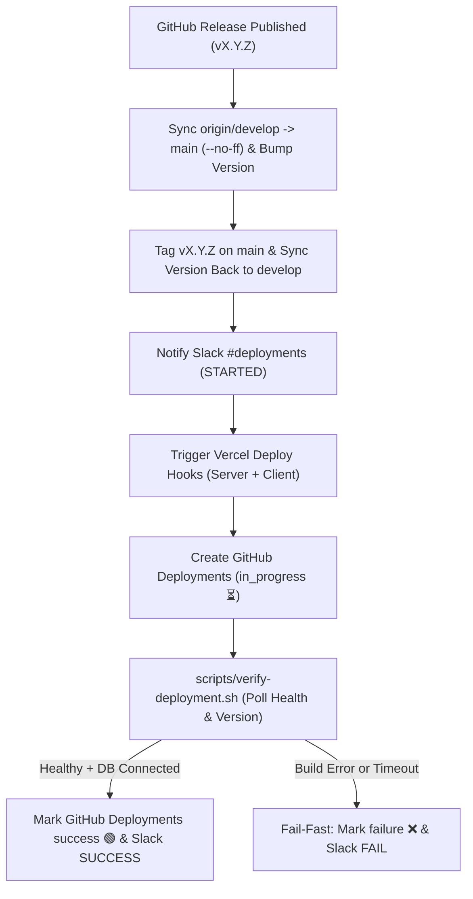

# CI/CD & Automated Production Releases

All three Prism Hub sub-repositories (`wonderlab`, `central-gateway`, `git-pulse`) operate independent CI/CD pipelines using standardized GitHub Actions workflows, Vercel Deploy Hooks, and Central Gateway Slack routing.

---

## 1. Continuous Integration (`.github/workflows/ci.yml`)

Triggered on pushes and pull requests to `develop` and `main`, running decoupled parallel jobs on `ubuntu-latest` (Node `24`, `pnpm 12.11.2`):

1. **`quality`**: `db:generate` -> `pnpm format:check` -> `pnpm lint` (`--max-warnings 0`) -> `pnpm typecheck`
2. **`unit-tests`**: `db:generate` -> `pnpm test` (Vitest / Jest)
3. **`e2e-tests`** _(Wonderlab)_: `postgres:16-alpine` service container -> `prisma migrate deploy` -> `db:seed` -> `pnpm test:e2e`
4. **`build`**: Depends on `quality` & `unit-tests` -> runs `pnpm build` for both Next.js client and NestJS server

CI status summaries are dispatched to Slack `#ci-cd` via Central Gateway (`POST /api/v1/notifications/slack/ci`).

---

## 2. Commit-Aware Release Drafter (`.github/workflows/release-drafter.yml`)

Every commit pushed to `develop` aggregates automatically into a GitHub Draft Release targeting `main` via `.github/scripts/update_draft_release.py`:

- Groups commits since the latest `v*` tag using **Conventional Commits** (`feat:`, `fix:`, `perf:`, `refactor:`, `docs:`, `chore:`, `ci:`, `test:`).
- Computes the next SemVer version (`major` on breaking changes, `minor` on `feat:`, `patch` on `fix:` / others).
- **Version Single Source of Truth**: Only official releases (`release: [published]` or tag `v*.*.*`) modify root, `client/`, and `server/` `package.json` versions (`scripts/sync-release-version.sh`). Never bump versions on draft releases or regular `develop` pushes.

---

## 3. Production Deployment Architecture (`.github/workflows/deploy.yml`)

### Live Production Targets

| Service             | Client (`vercel.app` / Domain)                                                 | Server API (`/api/v1`)                             | GitHub Deployment Environments                                   |
| :------------------ | :----------------------------------------------------------------------------- | :------------------------------------------------- | :--------------------------------------------------------------- |
| **Wonderlab**       | [wonderlab.io.vn](https://wonderlab.io.vn)                                     | `https://wonderlab-server.vercel.app/api/v1`       | `main - wonderlab-server`, `main - wonderlab-client`             |
| **Central Gateway** | [central-gateway-client.vercel.app](https://central-gateway-client.vercel.app) | `https://central-gateway-server.vercel.app/api/v1` | `main - central-gateway-server`, `main - central-gateway-client` |
| **Git Pulse**       | [git-pulse-app.vercel.app](https://git-pulse-app.vercel.app)                   | `https://git-pulse-server.vercel.app/api/v1`       | `main - git-pulse-server`, `main - git-pulse-client`             |

- Server production builds on Vercel run `prisma generate && (if [ -n "$DATABASE_URL" ]; then prisma migrate deploy; fi) && nest build`.
- `git-activity.yml` dispatches push, branch creation, and PR merge events to Slack `#git-activity` via Central Gateway.
- Child repositories store **only** `GATEWAY_SECRET_KEY`; raw `SLACK_BOT_TOKEN` stays strictly isolated inside Central Gateway.
